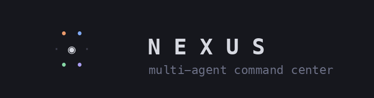
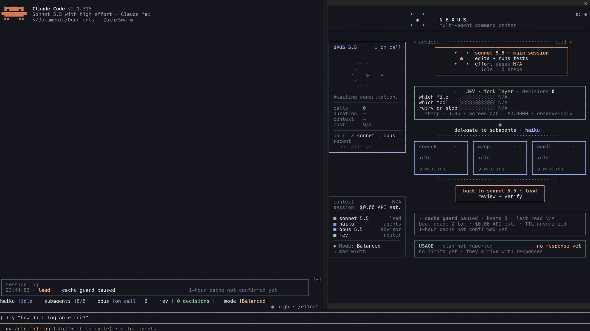
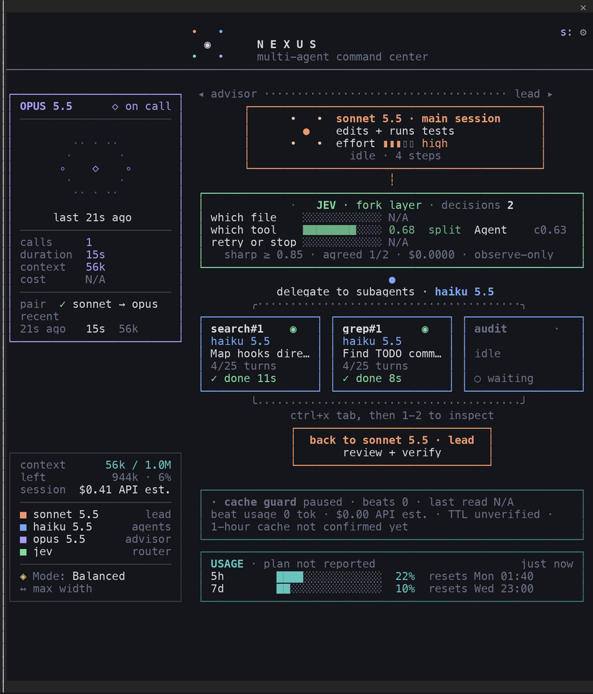
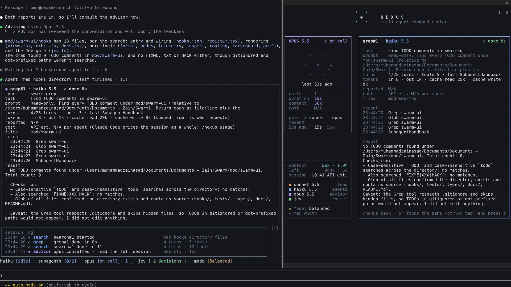
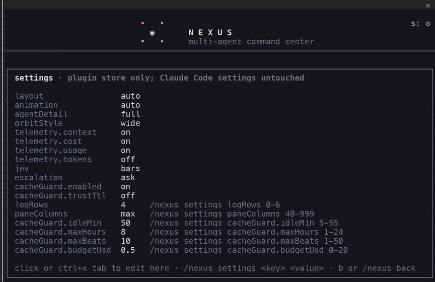
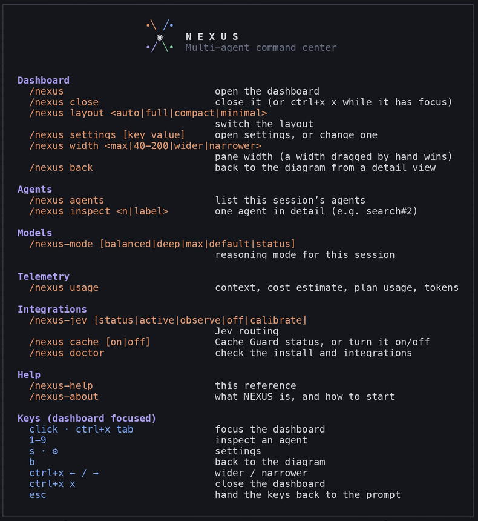

<div align="center">



## Your agents were always working. Now you can see them.

A live multi-agent dashboard, docked inside Claude Code's own terminal.


[Install](#install) · [Roles](#four-roles-one-view) · [Screenshots](#the-dashboard) · [Modes](#model-modes) · [Commands](#commands) · [Docs](#docs)

</div>

<br>

<div align="center">

<br>
<sub>A real turn, recorded live at 1920×1080 and played at 1.6×: two Haiku agents run side by side, then the Opus advisor is consulted. Nothing is simulated.<br><a href="mod/nexus/docs/media/nexus-demo-1080p.mp4"><b>▶ Watch the full 1080p video</b></a></sub>
</div>

<br>

## Install

```sh
claude plugin marketplace add muhzain05/Nexus
claude plugin install nexus@muhzain05 --scope user
```

Then start a new `claude` session in the **fullscreen TUI** (`"tui": "fullscreen"` in your Claude Code settings). On a wide terminal NEXUS docks on its own; anywhere else, type `/nexus`. Built for Claude Code 2.1.316 ([compatibility](mod/nexus/docs/compatibility.md)).

<details>
<summary>From a local clone</summary>

```sh
git clone https://github.com/muhzain05/Nexus
claude plugin marketplace add ./Nexus
claude plugin install nexus@muhzain05 --scope user
```
</details>

**Quick start:** `/nexus` → ask for real work (*"map this repo with subagents, then summarize"*) → try `/nexus-mode` and `/nexus usage`. `/nexus-about` explains everything in the terminal.

### Agent Skill (optional)

A companion skill teaches Claude to install, explain and troubleshoot NEXUS, and ships three optional Haiku agent definitions:

```sh
npx skills add muhzain05/Nexus --skill nexus -g -a claude-code
```

The skill doesn't install the dashboard; the two plugin commands above do. [skills/nexus](skills/nexus/SKILL.md)

<br>

## Four roles, one view

<table>
<tr>
<td width="50%" valign="top">


The lead. Plans, coordinates and builds: reads your request, edits and runs tests. Sonnet by default; Opus or Fable in stronger modes.

</td>
<td width="50%" valign="top">


Parallel subagents executing delegated work: mapping a repo, searching, reviewing. Each gets its own live card.

</td>
</tr>
<tr>
<td width="50%" valign="top">


The model the lead consults before difficult decisions. It reads the session and never writes code. Opus 5.5 in Balanced; Fable 5.1 in the stronger modes.

</td>
<td width="50%" valign="top">


Optional, needs a TypeSafe key. Answers small next-step questions: which file, which tool, retry or stop. Observe-only by default; [active mode](mod/nexus/docs/jev.md) may only retry or annotate the lead's read-only reads.

</td>
</tr>
</table>

<br>

## The dashboard



- **Lead, advisor and agents** with their real models, effort and state
- **One card per agent**; focus the dashboard and press `1`–`9` (or `/nexus inspect <label>`) to see its task, tools, files and answer. Built-in agents such as Explore are marked *fallback* with the model they really ran on
- **Context, session cost and plan usage**, straight from Claude Code
- **Model modes** you switch per session
- **Cache Guard** (optional) keeps the prompt cache warm while you're away
- **Motion only on real events**; idle means no redraws, and reduced motion is respected

A native plugin on Claude Code's mod API: no wrapper, no second terminal, no patched binary.

> **Honest by design.** Every number comes from Claude Code. Anything it doesn't report reads `N/A`, and estimates are labelled `API est.`

[Full dashboard tour →](mod/nexus/docs/dashboard.md)

<br clear="right">

<div align="center"><br><sub>Inspecting an agent, in the dashboard and in the conversation</sub></div>

<br>

<table>
<tr>
<td width="50%"></td>
<td width="50%"></td>
</tr>
<tr>
<td align="center"><sub><b>⚙ Settings</b>, kept in the plugin's own store</sub></td>
<td align="center"><sub><b>/nexus-help</b>, drawn in the transcript</sub></td>
</tr>
</table>

<br>

## Model modes

| Mode | Lead | Advisor |
|---|---|---|
| **Balanced** *(default)* | Sonnet 5.5 · high | Opus 5.5 |
| **Deep Engineering** | Opus 5.5 · xhigh | Fable 5.1 |
| **Maximum Reasoning** | Fable 5.1 · max | Fable 5.1 |

`/nexus-mode` applies to this session only. NEXUS may suggest a stronger mode before a hard prompt, but **never switches without your yes**. Fable bills to usage credits. Claude Code changes the advisor only on relaunch, so when a mode needs a different advisor NEXUS prints a one-line relaunch command for that session; your saved defaults are never edited. [Details →](mod/nexus/docs/dashboard.md#model-modes-in-detail)

<br>

## Commands

| Command | What it does |
|---|---|
| `/nexus` | open the dashboard (`close`, `layout`, `width`, `settings`, `agents`, `inspect`) |
| `/nexus-mode` | `balanced` · `deep` · `max` · `default` · `status` |
| `/nexus-jev` | `status` · `active` · `observe` · `off` · `calibrate` |
| `/nexus usage` | context, cost estimate, plan usage, tokens by model |
| `/nexus cache` | Cache Guard status · `on` · `off` |
| `/nexus doctor` | check the install and integrations |
| `/nexus-help` · `/nexus-about` | every command and key · introduction |

**Keys, with the dashboard focused:** `1`–`9` inspect · `s` settings · `b` back · `ctrl+x ←/→` resize · `ctrl+x x` close · `esc` back to the prompt.

<sub>[Full reference →](mod/nexus/docs/dashboard.md#every-command)</sub>

<br>

## Good to know

- **Cost:** the session figure is Claude Code's total at API prices; on a subscription it's an estimate, not a charge. Anything not reported reads `N/A`. [Telemetry →](mod/nexus/docs/telemetry.md)
- **Cache Guard** is off by default. Each beat costs a little and only pays off if you come back. [Cache Guard →](mod/nexus/docs/cache-guard.md)
- **Privacy:** your Claude Code settings are never edited. Jev is the only third-party service NEXUS calls, only with your key, and it receives just tool names, file basenames and error kinds. [Jev →](mod/nexus/docs/jev.md)
- **Limits:** the advisor appears only once its request ends; its tokens and cost, and per-agent cost, aren't reported to plugins (shown as `N/A`). The mod API is early access. [Compatibility →](mod/nexus/docs/compatibility.md)
- **Credits:** Cache Guard draws inspiration from [Cachebeat](https://github.com/ARahim3/cachebeat) by Abdur Rahim (@ARahim3); no code is reused and no endorsement is implied. [Acknowledgments →](ACKNOWLEDGMENTS.md)

<br>

## Docs

[Dashboard tour](mod/nexus/docs/dashboard.md) · [Telemetry](mod/nexus/docs/telemetry.md) · [Jev](mod/nexus/docs/jev.md) · [Cache Guard](mod/nexus/docs/cache-guard.md) · [Compatibility](mod/nexus/docs/compatibility.md) · [Troubleshooting & uninstall](mod/nexus/docs/troubleshooting.md)

<br>

<div align="center">


Created by **Muhammad Zain** · MIT licensed

</div>
