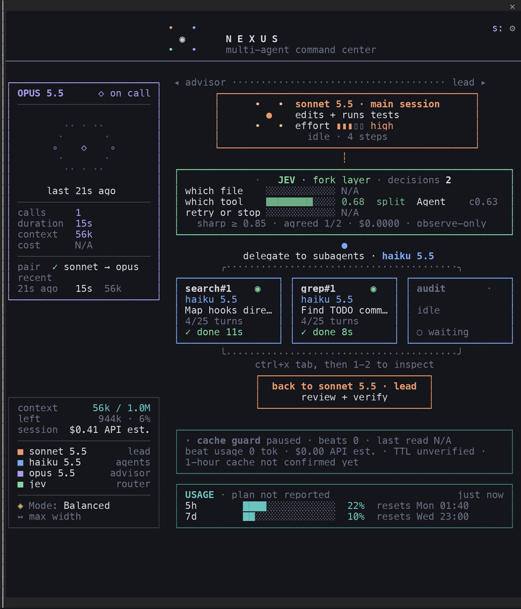
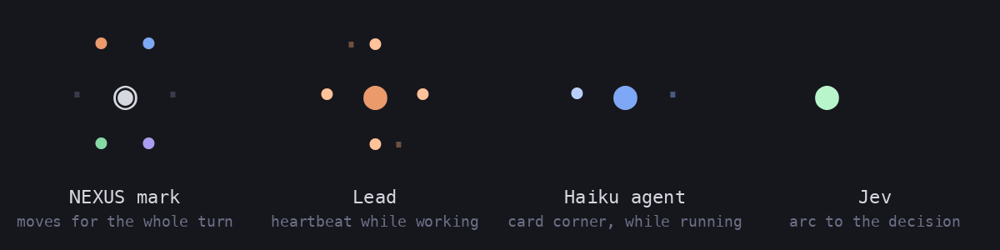
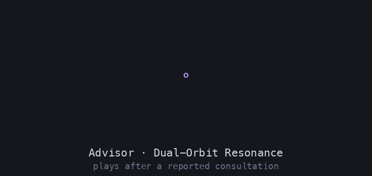
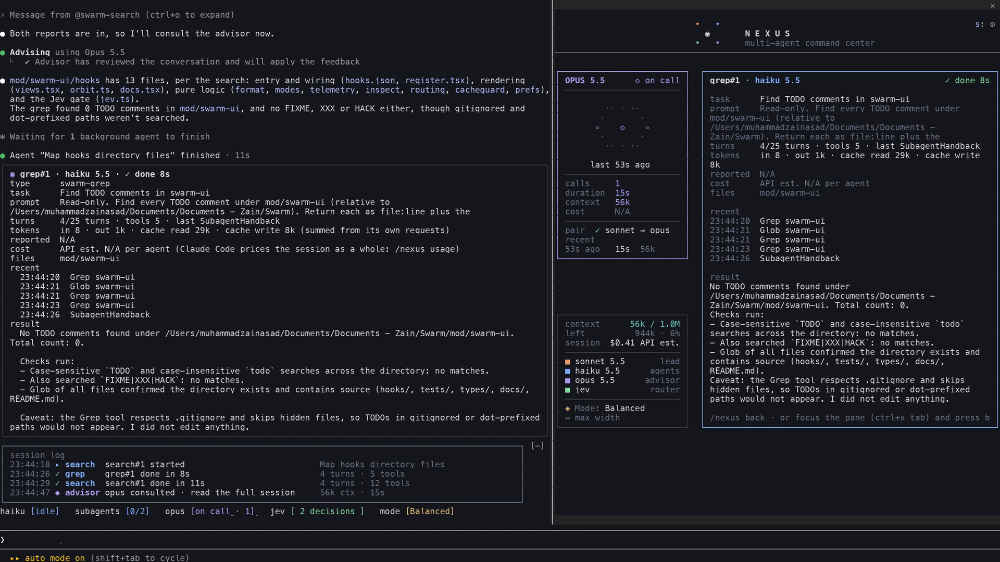
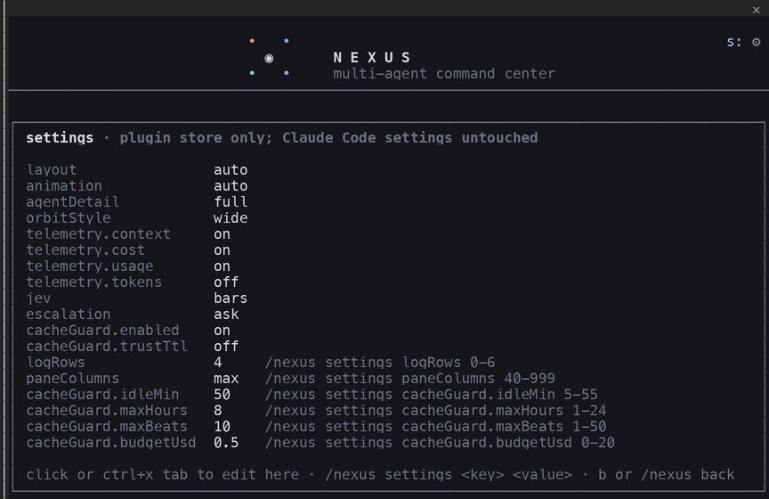
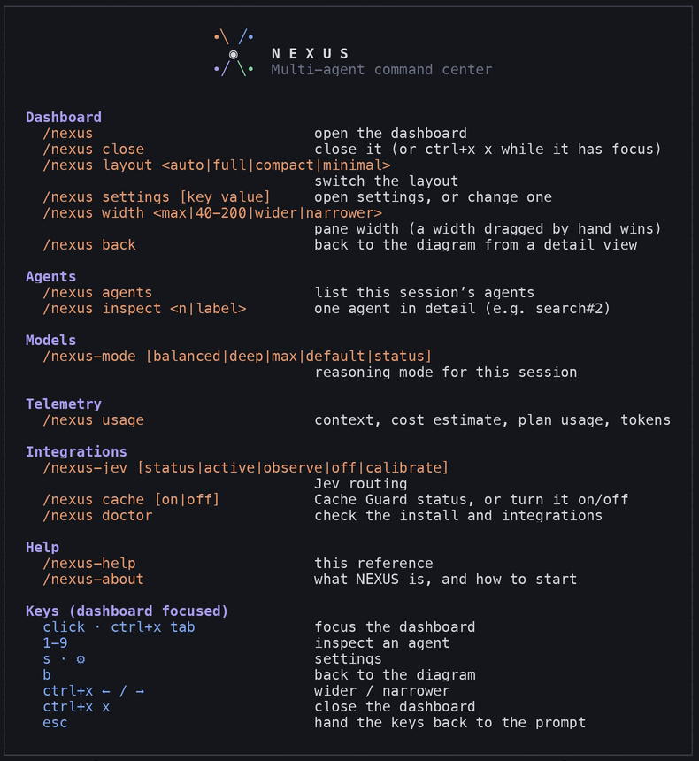
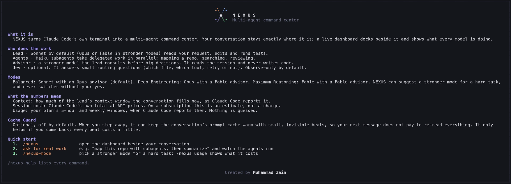

# The NEXUS dashboard

[← Back to the README](../../../README.md)

**① Header.** The NEXUS mark moves for as long as a turn runs, agents included, and settles when it ends. The **⚙** opens settings.

**② Advisor.** The advisor model (Opus 5.5, or Fable 5.1 in the stronger modes), when it was last consulted, how often and for how long, and how much context it read. It shows *Awaiting consultation.* until the first call.

**③ Lead.** The model that actually answered, its effort, and whether it's working, idle or waiting on you.

**④ Jev.** Routing answers as green bars: bright when **sharp** (≥ 0.85), muted when **split**.

**⑤ Agents.** One fixed card per agent instance (`search#1`, `grep#1`, …), each with a small orbit in its corner and its state on the bottom row. Agents outside your configured set are marked *fallback*.

**⑥ Cache Guard and USAGE.** The optional cache keeper, then your plan's rate-limit windows.

**⑦ Bottom left.** Context used and left, the session estimate, the running models and the current mode.

 

## Motion that means something

Every animation starts from a real event and stops when it ends. When nothing is happening, NEXUS doesn't redraw at all, and reduced motion swaps every animation for a still frame.

  

 
The advisor runs inside an API request, so Claude Code reports it only once that request ends. Its animation plays then, marked "reported just now", and never pretends to be live.

## Inspect any agent

Click the dashboard (or press `ctrl+x tab`) and press `1`–`9`, or type `/nexus inspect search#2`. You get the agent's task, state and run time, turns over its limit, tool calls, files touched, recent actions, tokens, and its final answer.

## Settings, help and onboarding

<table>
<tr>
<td width="50%"></td>
<td width="50%"></td>
</tr>
<tr>
<td align="center"><b>⚙ Settings</b>: layout, motion, telemetry, log rows, Jev, Cache Guard. Kept in the plugin's own store; your Claude Code settings are never touched.</td>
<td align="center"><b>/nexus-help</b>: every command and shortcut, drawn in the transcript</td>
</tr>
</table>

 <b>/nexus-about</b>: a first-run guide with a three-step quick start

## Every command

| Command | What it does |
|---|---|
| `/nexus` | open the dashboard · `close` to close it |
| `/nexus layout auto\|full\|compact\|minimal` | switch layouts (auto picks by width) |
| `/nexus settings [key value]` | open settings, or change one |
| `/nexus width max\|40-200\|wider\|narrower` | pane width (a width you drag by hand wins) |
| `/nexus back` | back to the diagram from a detail view |
| `/nexus agents` · `/nexus inspect <n\|label>` | list agents · open one |
| `/nexus usage` | context, cost estimate, plan usage, tokens by model |
| `/nexus-mode [balanced\|deep\|max\|default\|status]` | reasoning mode for this session |
| `/nexus-jev [status\|active\|observe\|off\|calibrate]` | Jev routing |
| `/nexus cache [on\|off]` | Cache Guard |
| `/nexus doctor` | check the install and integrations |
| `/nexus-help` · `/nexus-about` | reference · introduction |

**Keys, with the dashboard focused:** `1`–`9` inspect · `s` settings · `b` back · `ctrl+x ←/→` resize · `ctrl+x x` close · `esc` back to the prompt.

## Model modes in detail

| Mode | Lead | Advisor | When |
|---|---|---|---|
| **Balanced** *(default)* | Sonnet 5.5 · high | Opus 5.5 | everyday work |
| **Deep Engineering** | Opus 5.5 · xhigh | Fable 5.1 | refactors, tricky bugs, architecture |
| **Maximum Reasoning** | Fable 5.1 · max | Fable 5.1 | the hardest problems |

`/nexus-mode` switches the lead for this session only. Before a hard-looking prompt, NEXUS can suggest a stronger mode in a dialog, and **it never switches without your yes**. Fable bills to usage credits.

An advisor must rank at least as high as the lead, and Claude Code only lets an advisor change by relaunching the conversation. So when a mode needs a different advisor, NEXUS prints a one-line relaunch command that applies just to that session. Your saved defaults are never edited.
