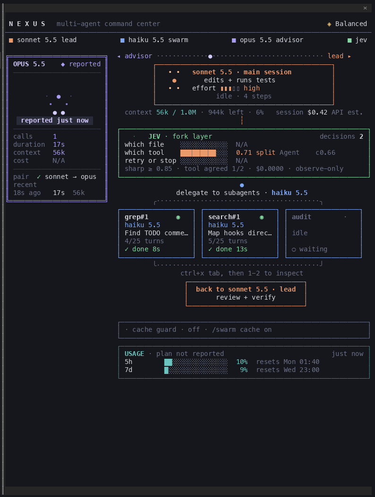
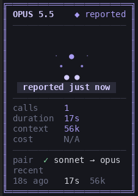
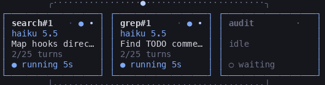
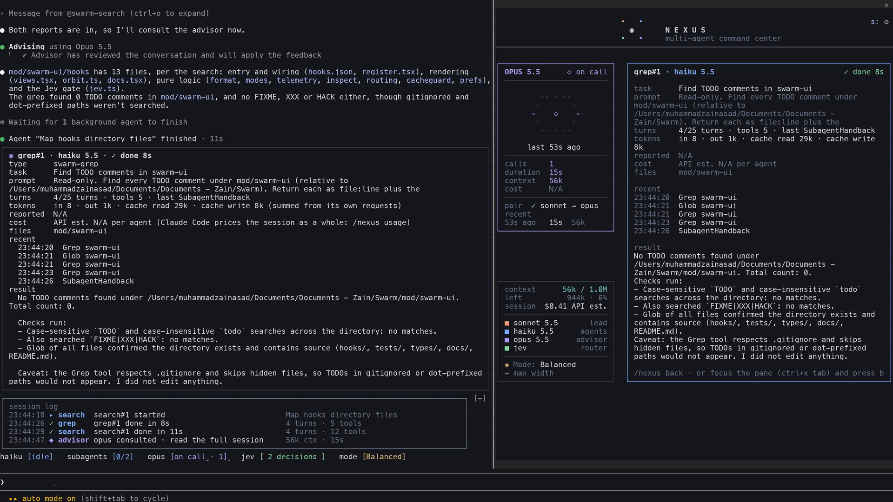

# NEXUS

**NEXUS** (the `swarm-ui` plugin) turns Claude Code's own terminal into a multi-agent command center: a Sonnet lead, Haiku subagents, an Opus or Fable advisor and an optional Jev router, drawn as a live diagram beside your conversation. It is a native Claude Code plugin built on the supported mod API. There is no wrapper, no second terminal and no patched binary.

Every number on the dashboard comes from Claude Code itself. Anything Claude Code doesn't report reads `N/A`.



| Advisor panel | Haiku cards |
|---|---|
|  |  |

The commands and plugin id keep the earlier `swarm` names (`/swarm`, `/swarm-mode`, `swarm-ui@claude-swarm`), so existing installs and settings keep working.

## Requirements
- Claude Code **2.1.316** (tested). The mod API is early access; see [Updates](#updates-and-compatibility).
- The full diagram docks beside the transcript in the fullscreen TUI (`"tui": "fullscreen"`). Narrower terminals get the compact or minimal layout.
- Nothing paid beyond Claude Code. Fable, Jev and Cache Guard are optional.

## Install
From GitHub (replace `<owner>/<repo>`):
```sh
claude plugin marketplace add <owner>/<repo>
claude plugin install swarm-ui@claude-swarm --scope user
```
From a local clone:
```sh
claude plugin marketplace add /path/to/clone
claude plugin install swarm-ui@claude-swarm --scope user
```
Start a new `claude` session. The pane opens on its own on a wide terminal; `/swarm` opens it anywhere.

## Quick start
| Command | What it does |
|---|---|
| `/swarm` | open the pane (ctrl+x tab focuses it) |
| `/swarm agents` · `/swarm inspect <n or label>` | list agents, open one |
| `/swarm usage` | context, cost, plan windows, tokens by model, with sources |
| `/swarm settings [key value]` · `/swarm layout full\|compact\|minimal\|auto` | preferences |
| `/swarm cache [on\|off]` | Cache Guard |
| `/swarm-mode [balanced\|deep\|max\|default\|status]` | model mode for this session |
| `/swarm-jev [status\|active\|observe\|off\|calibrate]` | Jev routing |

A read-only prompt that lights up every panel:
```
Read-only test, do not edit anything. Run swarm-search and swarm-grep in parallel: swarm-search lists the files in this repo's top folder, swarm-grep finds where the main entry point is defined. Then consult the advisor once, then answer in two lines.
```

## The dashboard
- **Advisor sidebar:** the session's advisor model (Opus 5.5, Fable 5.1, ...), when it was last consulted, how many calls, the main thread's context at that call, the call's duration, and a short history. It shows "Awaiting consultation." until the first call. Cost reads N/A, because Claude Code doesn't report advisor tokens to plugins. The advisor runs inside an API request and is only reported when that request ends, so its animation plays after the fact and is labelled "reported just now". It never claims to be live.
- **Lead:** the model that actually answered (from the response, not the configuration), its effort, and whether it is working, idle or waiting on a permission dialog.
- **Telemetry line:** `context 97k / 200k · 103k left · 49%` are the main thread's figures as Claude Code's status line reports them. `session $0.82 API est.` is what Claude Code's `/cost` ledger totals at API prices; it isn't a subscription charge.
- **Jev:** the latest answers as bars: probability, sharp or split, and confidence. Tool agreement, spend and routing state appear underneath.
- **Haiku cards:** one fixed-size card per agent instance (`search#1`, `search#2`, ...). Each card shows its name with a small orbit in the top-right corner, then the model, task, turns, and the state (running, done, failed or cancelled) on its bottom row. Long text is cut with `…`. Agent types outside the configured swarm are marked `fallback` and get a rounded border.
- **Cache Guard:** under the back-to-lead box (see below).
- **USAGE:** see below.



### Agent inspection
Focus the pane (ctrl+x tab) and press `1`–`9` to open an agent; `b` goes back. Or use `/swarm inspect search#2`.

The detail view shows:
- task and prompt;
- state and run time;
- turns over the agent's `maxTurns`, and tool calls;
- tokens summed from its own requests, plus the total the Agent tool reported;
- files it touched and its recent actions;
- its final message, and why it stopped when it failed or was cancelled.

Per-agent cost reads N/A, because Claude Code prices only the session as a whole.

### Layouts and settings
`auto` (the default) draws `full` when the pane is at least 84 columns wide, `compact` when it's narrower, and a one-line list when it's inline or very narrow. Choosing `full` on a narrow terminal still falls back. `minimal` closes the pane and puts a status strip above the prompt.

`/swarm settings` lists every setting. They are kept in the plugin's own store and never in Claude Code's settings.

| Setting | Values | Default |
|---|---|---|
| `layout` | auto, full, compact, minimal | auto |
| `animation` | auto (follows Claude Code's reduce-motion setting), full, reduced, off | auto |
| `agentDetail` | brief, full | full |
| `advisorOrbit` | wide, tight | wide |
| `telemetry.context` / `.cost` / `.usage` / `.tokens` | on, off | on / on / on / off |
| `logRows` | 0–6 | 4 |
| `jev` | bars, line, hidden | bars |
| `escalation` | ask, off | ask |
| `cacheGuard.*` | see Cache Guard | off |

### Usage monitor
The USAGE box shows only the rate-limit windows Claude Code received with its last API response:
- `5h` and `7d`, plus `7d opus`, `7d sonnet` and others when they are reported;
- each with its reset time in your local zone.

Bars are teal below 70%, amber from 70% and red from 90%. They turn grey and say **stale** when no response has arrived for 15 minutes, because the figures only refresh with responses. Swarm makes no extra requests to fetch them.

Two limits:
- **Plan name:** Claude Code doesn't tell a plugin which plan you're on unless its organisation manages it, so the box says "plan not reported" rather than guess Pro or Max.
- **Fable weekly limit:** gets a row only if Claude Code reports a window named after Fable. Claude Code 2.1.316 knows no such window, and none is invented.

`/swarm usage` shows every figure with its source and age.

## Model modes
| Mode | Lead | Advisor |
|---|---|---|
| Balanced (default) | Sonnet 5.5, high | Opus 5.5 |
| Deep Engineering | Opus 5.5, xhigh | Fable 5.1 |
| Maximum Reasoning | Fable 5.1, max | Fable 5.1 |

`/swarm-mode` changes the lead model and effort for this session only. The advisor can't change in-session without rewriting your saved default, and Swarm never does that.
- **When a mode needs a different advisor:** `/swarm-mode` prints a relaunch command (`claude --resume <id> --model … --effort … --settings '{"advisorModel":"…"}'`) whose advisor lasts only for that process.
- **Invalid pairings are refused with the reason**, because the API rejects them: a lead may not outrank its advisor.
- **Escalation:** before a prompt that looks like a hard task, Swarm can suggest a stronger mode in a dialog. It decides with keyword rules first, and asks Haiku when the rules are unsure, at most 20 times a session. It never switches without a yes. Fable bills to usage credits.

## Jev (optional)
[TypeSafe](https://typesafe.ai) Jev answers small multiple-choice questions about what the lead is doing.
- **Key:** set `TYPESAFE_API_KEY`, or on macOS store it in the login Keychain:
  ```sh
  security add-generic-password -s claude-swarm-typesafe -a "$USER" -w
  ```
  It is held in memory only and never drawn or logged.
- **Default mode:** observation only.
- **`/swarm-jev active`:** first runs 6 fixed calibration cases. Then, for the lead's read-only `Read`/`LSP` calls only, Jev may:
  - re-run a failed read once (at most 5 times a session);
  - attach an optional "next file" note.

  It acts only when p ≥ 0.85 and confidence ≥ 0.6, and everything else falls back to the lead.
- **Never touched:** shell commands, edits, permissions or subagents.
- **Limits:** 30 requests a minute, $0.50 a session, 2s timeout.
- **What leaves your machine:** only tool names, file basenames and the kind of an error.

## Cache Guard (optional, off by default)
Claude Code's prompt cache expires after a period of inactivity. When it does, the next message pays to re-read the whole conversation. Cache Guard sends a small **beat** after N idle minutes so the cache stays warm while you're away.

```
cache guard warm · next 41m · beats 2 · last read 100%
beat usage 105k tok · $0.02 API est. · TTL 1h
```

**How a beat works:** it is a Claude Code model fork of the main thread's last request. A fork:
- makes no turn and adds no transcript entry;
- has every tool denied;
- is never seen by Swarm's own hooks, so it can't trigger mode changes, escalation, Jev or the advisor.

**When it beats:**
- **Never while busy:** not while the lead works, an agent runs or a permission dialog waits.
- **Never past the lifetime:** once idle time exceeds the cache lifetime, a beat would only pay to rebuild the cache, so it stands down.

**Its limits:** idle minutes (default 50), hours (8), beats (10) and an API-estimate budget ($0.50). The budget is checked before a beat that would pass it.

**Cache lifetime (TTL):** the guard won't assume one. It looks for evidence:
- a subagent's 1-hour cache writes;
- a real request still served from cache after more than 6 idle minutes;
- or a beat.

Without evidence it pauses unless you set `cacheGuard.trustTtl on`. A beat counts as warm when the cache served at least as much as it had to write.
- **First beat:** a session's first beat writes its own suffix once. Measured live: 30k read, 22k written.
- **Later beats:** read everything (52k read, 0 written, still at 7 idle minutes).

A warm beat doesn't guarantee your next request hits the cache, so `/swarm cache` also shows what that next request actually read.

**Cost trade-off.** All figures are multiples of the conversation's input price; Anthropic prices cache reads at about 0.1× and 1-hour cache writes at about 2×.

| What happens | Without Cache Guard | With Cache Guard |
|---|---|---|
| You return within the TTL | 0.1× | 0.1× (no beat) |
| You return after the TTL | about 2× (cache rebuild) | 0.1× per beat, then 0.1× |
| You never return | 0 | up to 0.1× per beat, wasted |

It pays off only if you come back after the cache would have expired. If you abandon the session, every beat is extra cost. Swarm reports what the beats cost and shows **savings as N/A**, because it can't know whether you'll return.

**States:** OFF, ARMED, REFRESHING, WARM, EXPIRED, PAUSED, ERROR.

Cache Guard draws inspiration from [Cachebeat](https://github.com/ARahim3/cachebeat), created by [Abdur Rahim (@ARahim3)](https://github.com/ARahim3). See [ACKNOWLEDGMENTS.md](../../ACKNOWLEDGMENTS.md) for what was adapted and what is Swarm's own. No Cachebeat code is reused, and no endorsement is implied.

## Privacy
Swarm reads only what Claude Code gives plugins: usage figures, model names, agent events and tool names. It keeps that in the session's memory and in the plugin's preference store, and sends nothing anywhere except:
- the Jev requests described above, when you configure a key;
- Cache Guard beats, which are ordinary Claude requests, when you enable it.

API keys are never written to disk by Swarm, logged or drawn.

## Troubleshooting
| Problem | Fix |
|---|---|
| No pane | Use the fullscreen TUI and run `/swarm`. On narrow terminals use `/swarm layout compact`, or `minimal` for the strip. |
| Hooks seem inactive | Run `claude --debug` and look for lines starting with `swarm-ui:`. A broken hook is skipped on its own and Claude Code keeps working. |
| Jev says `off (no key)` | Set `TYPESAFE_API_KEY`, or add the Keychain item above, then start a new session. |
| USAGE says `no limits reported yet` | Figures arrive with the first response. API-key and cloud-provider sessions have no plan windows. |
| Cache Guard `PAUSED (1-hour cache not confirmed yet)` | It will confirm by itself after an agent run or a longer idle gap, or set `cacheGuard.trustTtl on`. |

## Updates and compatibility
The mod API moves between Claude Code releases. After an update:
```sh
claude plugin validate mod/swarm-ui && claude plugin test mod/swarm-ui
```
Preferences are versioned: values saved by an older Swarm are migrated or reset to defaults, never misread.

## Uninstall
```sh
claude plugin uninstall swarm-ui@claude-swarm
claude plugin marketplace remove claude-swarm
```
Swarm changes none of your Claude Code settings. If you stored a Jev key in the Keychain, remove it with `security delete-generic-password -s claude-swarm-typesafe`.

## Known limitations
- The pane is at most 45% of the terminal width; the full diagram needs about 190 columns. Fonts are your terminal's.
- Advisor activity is visible only after the request it ran in ends, and advisor tokens and cost aren't reported to plugins.
- The plan name (Pro or Max) and a Fable weekly window are shown only if Claude Code reports them.
- Per-model and per-agent dollar costs aren't priced by Claude Code; only the session total is.
- The advisor can change only through a session-scoped relaunch, never in-session.
- Jev routing covers only the lead's read-only `Read`/`LSP` calls.
- The Jev Keychain lookup is macOS only; elsewhere use the environment variable.

## License
MIT. See [LICENSE](../../LICENSE).
